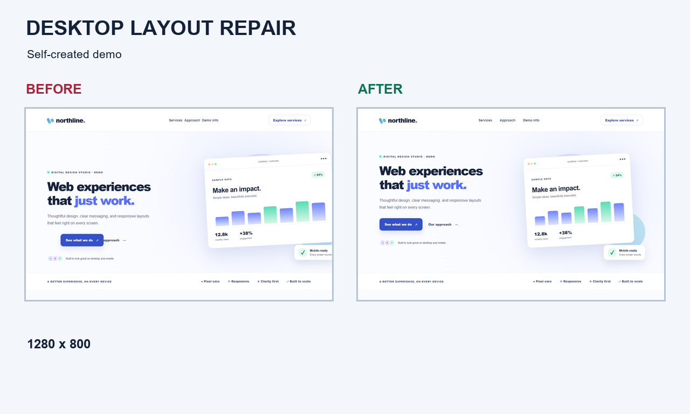
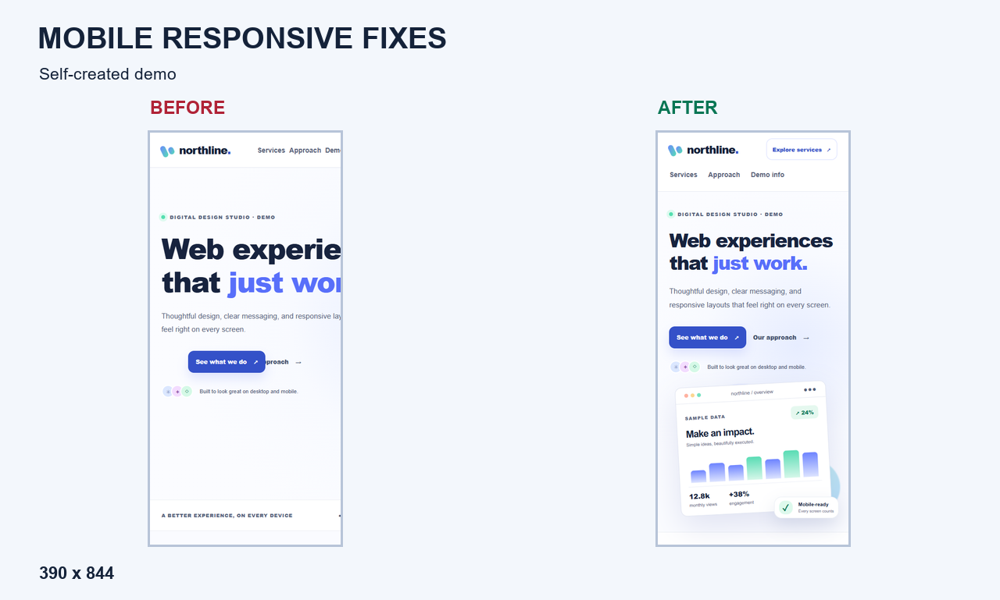

# STWIFT — HTML/CSS Layout Repair Demo

**This is a self-created demonstration project, not a completed client order.**

Northline is a fictional landing page for demonstrating small HTML/CSS layout and responsive repairs. The same content has an intentionally broken **Before** state and a corrected **After** state. Dashboard numbers are sample data, not business results. This is a technical portfolio sample by STWIFT, not a testimonial or client case study.

## Run the website

Open `index.html` in a modern browser. No installation, build, account, external font, API, or network service is required for the page itself. For a local HTTP preview, from the project folder with a working Python 3 installation:

```sh
python -m http.server 8000 --bind 127.0.0.1
```

- After: <http://127.0.0.1:8000/index.html>
- Before: <http://127.0.0.1:8000/index.html?broken=1>
- `?broken=0` also selects After.

On systems using `python3` or `py -3`, substitute that command. On Windows, a Microsoft Store alias is not a working Python interpreter; use the full path to an installed interpreter if needed. Stop the preview with Ctrl+C. The test runner starts and stops its own loopback HTTP server on a free port.

## Technology and structure

HTML5, CSS Grid/Flexbox and media queries implement the site. One short inline script selects Before from the URL. The illustration is drawn with CSS; there are no external image assets or runtime dependencies. Python/Playwright test the site; Pillow composes gallery images.

```text
index.html                 shared semantic page and URL mode switch
assets/style.css           responsive layout and accessibility styles
assets/broken.css          intentional defect overrides; unchanged by the audit
screenshots/               raw browser PNGs and source/capture hash manifest
gallery/                  three composed promotional PNGs (1280 × 769)
tests/check_layout.py      self-hosted browser regression tests
tests/layout_metrics.js   geometry, links, text visibility and layout measurements
tests/contrast.js         scoped text contrast checks
tools/build_gallery.py    gallery composition and capture integrity checks
requirements-dev.txt       pinned direct and transitive test/image dependencies
evidence/                 recorded layout, baseline and dependency-audit results
AUDIT_REPORT_RU.md          detailed audit, limitations and service-scope assessment
CODEX_REVIEW.md             instructions for a future independent review
```


## Before defects and After repairs

| Intentional Before behavior | Cause in `assets/broken.css` | After behavior |
|---|---|---|
| Horizontal overflow on narrow screens | 650–780px containers, fixed columns and shifted visual | Flexible containers; stacked hero and cards at 850px and below |
| Mobile navigation extends off-screen | Desktop header retained at 650px | All navigation links remain visible on a wrapping second row |
| Primary action overlaps the second action | 55px horizontal translation | Actions follow the normal flex layout |
| Hero text and visual misaligned | Vertical/horizontal transforms and oversized panel | Aligned responsive grid with bounded illustration |
| Uneven, staggered service cards | Unequal columns and a translated second card | Equal desktop cards; vertically stacked narrow-screen cards |

The audit also repaired real defects in the previous After: clipping hid an off-screen header action at 320px; a floating note covered illustration text at 851px; several text colors lacked contrast; mobile navigation was hidden; a Contact link targeted an intentionally non-deliverable email address. Focus styles, a skip link, useful local navigation and a reduced-motion rule were added.

Both states share the updated content, colors and accessibility improvements. Before is a controlled reproduction of layout defects, **not an untouched historical snapshot**. No new defect rules were added. The original `broken.css` is byte-for-byte preserved. After has no page-level overflow clipping; the illustration panel retains `overflow: hidden` only for its rounded artwork boundary.

## Install and run tests

Validated environment: Python 3.13.15, Playwright 1.64.1 and installed Google Chrome 157.0.8103.39 on Windows. Use a working Python 3.13 installation for the same dependency set.

Windows PowerShell:

```powershell
py -3.13 -m venv .venv
.\.venv\Scripts\python.exe -m pip install -r requirements-dev.txt
.\.venv\Scripts\python.exe -m playwright install chromium
.\.venv\Scripts\python.exe tests\check_layout.py
```

If `py` is unavailable, replace the first command with `& 'C:\path\to\python.exe' -m venv .venv`. No PowerShell activation or execution-policy change is needed.

macOS/Linux equivalents:

```sh
python3.13 -m venv .venv
.venv/bin/python -m pip install -r requirements-dev.txt
.venv/bin/python -m playwright install chromium
.venv/bin/python tests/check_layout.py
```

To use an already-installed Chrome on Windows instead of downloading bundled Chromium, set this before the test command (adjust the path if required):

```powershell
$env:CHROME_PATH = 'C:\Program Files\Google\Chrome\Application\chrome.exe'
```

`CHROME_PATH` affects only the Chromium project. A requested browser that cannot launch is a test failure, not a silent skip. Additional engines can be installed and explicitly requested:

```sh
python -m playwright install firefox webkit
python tests/check_layout.py --browsers chromium firefox webkit
```

`--screenshots` requires `chromium` in the requested browser list; incompatible arguments are rejected before any output is written. `.gitattributes` keeps text files as LF so Windows checkouts preserve the source hashes.

The test loads actual HTML and CSS over HTTP and uses real query strings. It checks both states at **320, 375, 390, 480, 481, 768, 850, 851, 1024, 1280, 1440 and 1920 CSS pixels**. It checks response/runtime errors, document and element bounds, text visibility while scrolling, selected overlaps, local links, service-card alignment, keyboard navigation at four sizes, visible focus, text contrast, metadata and Before defects. It also checks that After content/navigation remain available without JavaScript. Runtime external requests are blocked and reported.

Results are written to ignored `test-results/results.json`. Exit status is nonzero for failed assertions or unavailable requested engines. These checks are scoped to this demo; they do not constitute a full accessibility certification or prove every possible overlap is absent.

## Regenerate screenshots and gallery

Use the appropriate virtual-environment Python executable from above:

```sh
python tests/check_layout.py --screenshots
python tools/build_gallery.py
```

Raw desktop pairs use **1280 × 800**; mobile pairs use **390 × 844**, with device scale factor 1. `*_viewport.png` files capture exactly the visible viewport. The other PNGs capture the full document, which can be wider than the viewport in Before. Full-document dimensions therefore differ by state; use viewport pairs for direct comparisons.

`screenshots/manifest.json` records SHA-256 values for source files and captures plus browser details. The gallery builder rejects modified sources or mismatched screenshots. It preserves the complete viewport and aspect ratio (rounded to the nearest output pixel), places labels outside screenshots and rejects overlapping/out-of-bounds elements. No retouching or generated imagery is used. Windows Arial, Linux DejaVu and macOS Arial are supported; Pillow's embedded font is the fallback. Optional `GALLERY_FONT_REGULAR` and `GALLERY_FONT_BOLD` select font files.

Gallery PNGs are promotional compositions from real captures, not raw screenshots or proof of a client engagement. Their 1280 × 769 size follows the [Fiverr image guidance](https://help.fiverr.com/hc/en-us/articles/15863342952977-Creating-Gig-images-and-tagging-your-Gig-gallery), checked on 9 November 2026. Check the actual Fiverr thumbnail preview before posting; small site text is not intended to be read at thumbnail scale.

### Desktop Before / After



### Mobile Before / After



Full-resolution raw viewports: [desktop Before](screenshots/before_desktop_viewport.png), [desktop After](screenshots/after_desktop_viewport.png), [mobile Before](screenshots/before_mobile_viewport.png), [mobile After](screenshots/after_mobile_viewport.png).

## Recorded results and limitations

The recorded Chrome run passed all **24 layout cases**. After had `scrollWidth == clientWidth` at every tested width. At 390/768/1280px, Before scroll widths were 977/1001/1296px respectively; the intentionally displaced action and uneven desktop cards also reproduced. See [recorded results](evidence/layout-results.json) and the [Russian audit report](AUDIT_REPORT_RU.md).

Firefox and WebKit could not launch because their Playwright executables were not installed; no passes are claimed for them. Real iOS/Android devices, assistive-technology sessions, browser zoom/text-only zoom, formal HTML validation and complete WCAG conformance were not tested. System fonts may change line breaks and screenshot pixels between machines. The illustration is CSS, so raster-image loading tests have no site images to exercise. The demo switch requires JavaScript; After remains readable without it. No backend, form delivery, CMS, authentication or payment feature is implemented.

## Publication and reuse

Suggested repository name: `stwift-html-css-demo`. Review the files and choose an appropriate license before advertising third-party reuse. No license or ownership rights are invented by this audit. There is no Git history or remote in the supplied project; no public repository, push, release or deployment has been created.

Keep `.venv`, caches, raw temporary logs and local editor state out of publication. The included `.gitignore` covers these. `evidence/` contains shareable technical results rather than client data. This project is suitable as a starting point for small static-site QA; adapt selectors and intentional-defect assertions before reusing its tests elsewhere.
